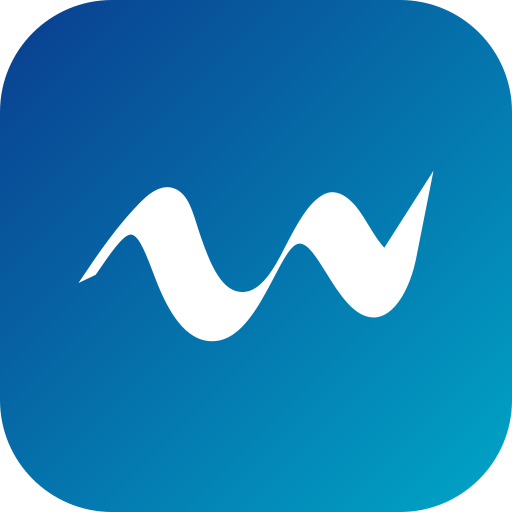

<p align="center"></p>

# Wavium

**A self-hosted personal hub built for humans *and* AI agents.**

> Wavium was called Atrium while it was built: the code, the repository, the
> containers and the environment variables (`ATRIUM_*`) keep that name.

Wavium is a hard fork of [Nextcloud](https://nextcloud.com) 34.0.5. It keeps
Nextcloud's backend (files, calendar, contacts, tasks, mail, DAV, OCS) and its
client compatibility, and adds what an AI agent needs to work with your data
properly:

- **A new web UI in React**, served by **Bun** instead of Apache (Bun talks
  FastCGI to PHP-FPM). Mail, Calendar, Contacts, Tasks, Files, Notes, Activity,
  Dashboard, Daily Todo and most settings are ported; the rest is shown in a frame.
- **An agent layer**: agents are accounts owned by a human, with permissions per
  app and action (`off` / `allowed` / `approval`), tools over **MCP** and REST,
  an **approval queue** (frozen, hashed payloads), and **events** pushed to the
  agent (signed webhook doorbell + cursor), plus a pause switch.
- **A reworked Mail app**: LLM classification (10 categories, urgency, needs
  reply/action), Atrium keeps its **own copy of every mail** (the database is the
  source of truth), DB-first writes with a retry queue, and a hard rule:
  **mail is never deleted** (delete = Trash, kept at least 30 days).

Stock Nextcloud clients (desktop, mobile, DAVx⁵) keep working: DAV, OCS, login
flow v1/v2, OAuth2 and public links are unchanged ([ADR 0008](docs/architecture/0008-client-compatibility.md)).

## Install it on your server

```sh
git clone <this repository> wavium && cd wavium
bash deploy/wavium/install.sh
```

One command: it checks Docker, asks your domain name, sets up HTTPS (Caddy and
Let's Encrypt), creates the admin account and prints the address. Details,
backups and updates: [`deploy/wavium/README.md`](deploy/wavium/README.md).
Inside Wavium, **Settings > Tutorial** gives a two-minute tour and **Settings >
Move from Google** brings Gmail, Google Calendar, Contacts and Drive over.

## Run it (development)

Requirements: Docker (with compose) and `make`. Nothing else is installed on
the host. Works on x86-64 CPUs without AVX (Bun *baseline* build) and on arm64.

```sh
make up          # first start installs everything (a few minutes)
```

Open http://localhost:8092 and sign in with a demo account:

| User | Password | |
| --- | --- | --- |
| `alice` | `alice-demo-pass` | mail, events, tasks, contacts, files |
| `bob` | `bob-demo-pass` | same, smaller |
| `admin` | `admin-demo-pass` | administrator |

Demo mail lives in a throwaway [GreenMail](https://greenmail-mail-test.github.io/greenmail/)
server: nothing reaches a real mail server. Code is bind-mounted: PHP changes
are live, the Bun server restarts and the React UIs rebuild on save.

| Command | |
| --- | --- |
| `make up` / `make down` | start / stop the dev stack |
| `make reset` | wipe the dev instance and reload the demo data |
| `make test` | Bun server tests, web tests (vitest), Atrium PHPUnit, Daily Todo |
| `make lint` | TypeScript typecheck, PHP and shell syntax |
| `make build` | production build of the React UIs |
| `make logs`, `make shell`, `make occ ARGS="…"` | |

Every setting has a default; see [`.env.example`](.env.example) to change ports
or run several checkouts side by side.

## Connect an agent

Settings › Agents › *New agent* creates the agent and shows its MCP URL and
token. For example with Claude Code:

```sh
claude mcp add --transport http atrium http://localhost:8092/agent/mcp \
  --header "Authorization: Bearer <token>"
```

REST: `POST /agent/v1/tools/<tool>`, OpenAPI at `/agent/v1/openapi.json`.
Contract: [ADR 0009](docs/architecture/0009-agent-layer-mail-first.md).

## Layout

| Path | |
| --- | --- |
| `server/` | Bun web server and the agent layer (`server/agent/`) |
| `core/web/` | React shell, design system (`@atrium/ui`), SDK (`@atrium/sdk`) |
| `apps/<id>/web/` | React UI of each app |
| `apps/mail/` | Mail app with Atrium's classification and local copy |
| `docs/architecture/` | Architecture decisions (ADR 0001–0009) |
| `docs/lessons.md` | Lessons learned so far |
| `deploy/` | Production image and stack; `deploy/dev/` dev stack scripts |

## Contributing

- Read [`AGENTS.md`](AGENTS.md): the project rules (they apply to humans too),
  the map of the code, how to test.
- Work on a branch, keep it small, add tests; `make lint test` must pass.
- New code is TypeScript (Bun) where possible.
- The task list is [`TASKS.md`](TASKS.md), the plan [`PLAN.md`](PLAN.md).
  AI agents work at night on `night/<ID>` branches ([`night.sh`](night.sh));
  merging into `main` is always done by a human.

## Production

Fresh installs: [`deploy/wavium/`](deploy/wavium/README.md) (above). The image is
built by `deploy/build.sh`; [`deploy/README.md`](deploy/README.md) also covers taking
over an existing Nextcloud install.

## License

AGPL-3.0, like Nextcloud. See [COPYING](COPYING). Atrium-specific files carry
`SPDX-FileCopyrightText: 2026 Atrium contributors`.
