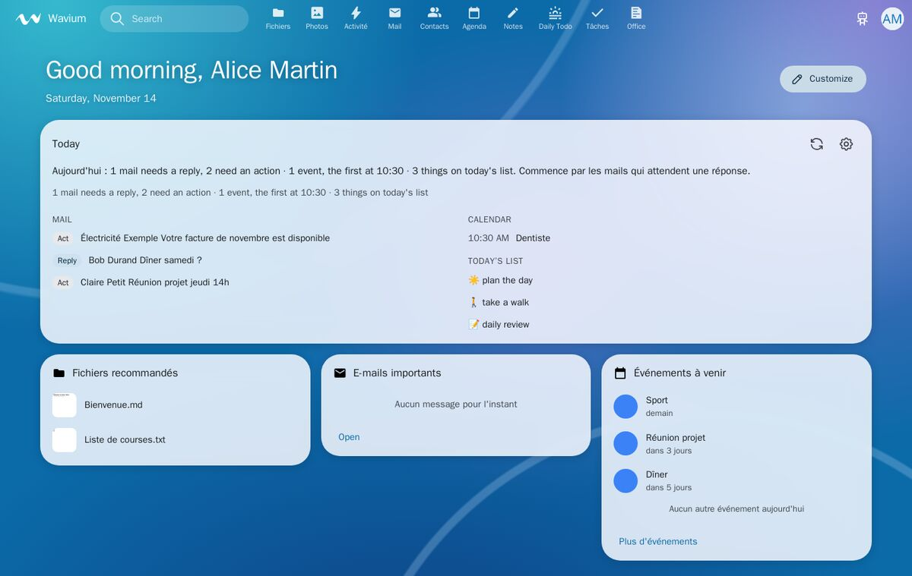
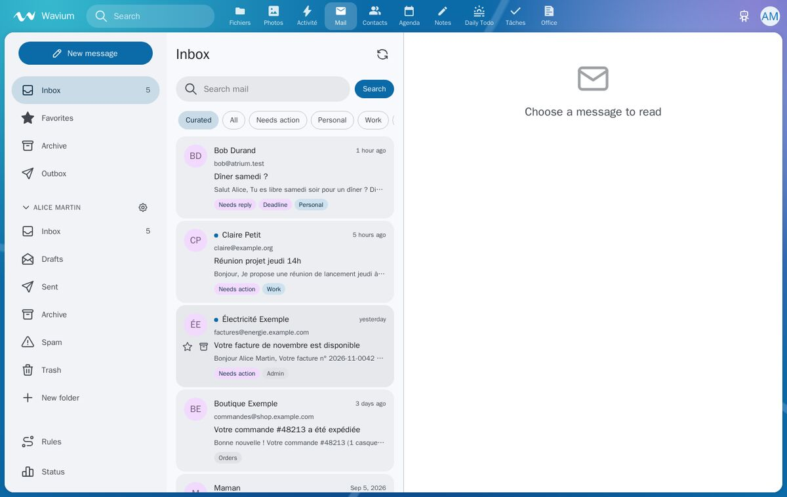
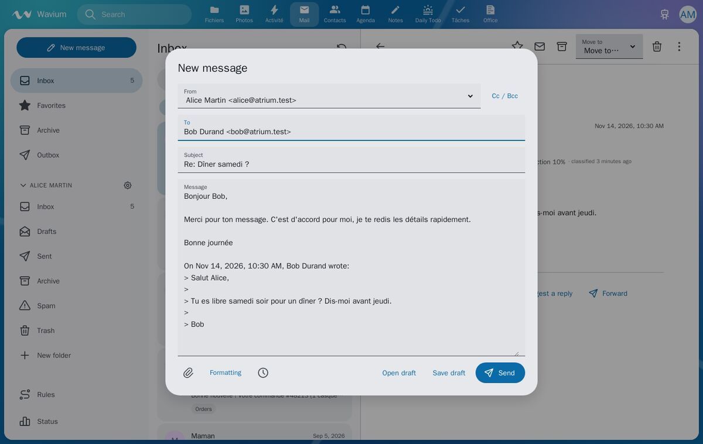
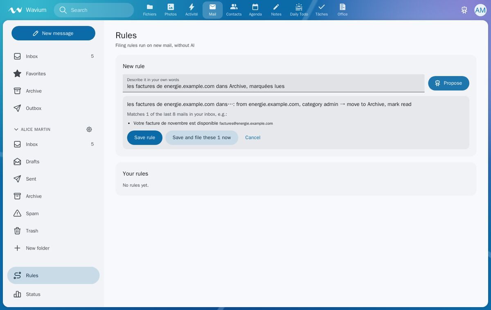
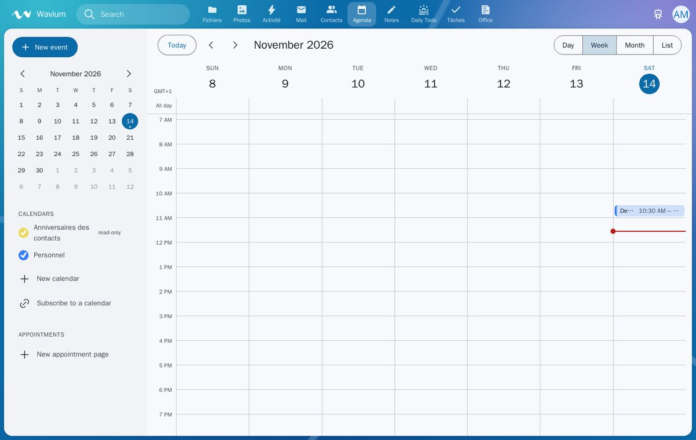
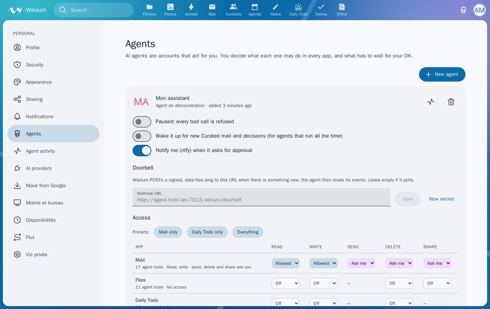
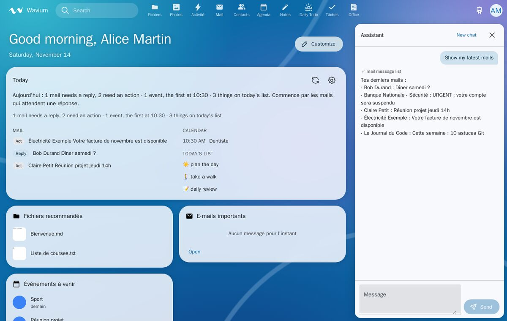
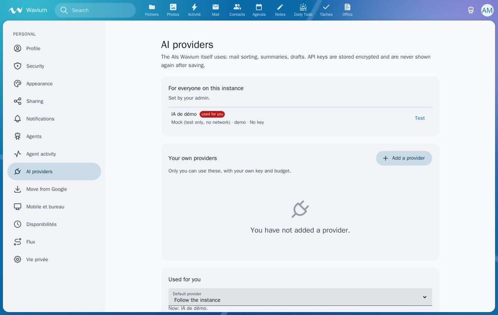
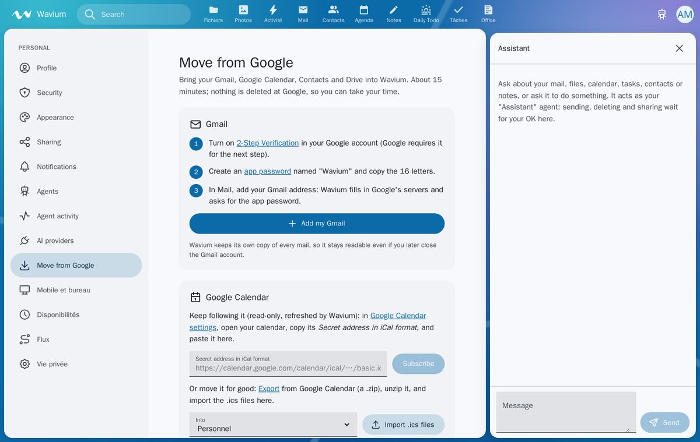

<p align="center"></p>

<p align="center">
  <a href="https://github.com/tungsten-w/wavium/actions/workflows/ci.yml"></a>
  <a href="COPYING"></a>
  
  
  
</p>

<p align="center">
  <b>A self-hosted personal hub built for humans <i>and</i> AI agents.</b><br>
  Mail that sorts itself, a calendar, tasks, contacts and files, and AI agents that work for you, with your permission.
</p>

<p align="center">
  <a href="#-install-it">Install</a> ·
  <a href="#-what-it-does">Features</a> ·
  <a href="#-connect-an-agent">Agents</a> ·
  <a href="#-leaving-google">Leaving Google</a> ·
  <a href="#run-it-locally-development">Develop</a>
</p>

<p align="center"></p>

## ✨ What it does

<table>
<tr>
<td width="50%"></td>
<td width="50%"></td>
</tr>
<tr>
<td><b>📬 Mail that sorts itself.</b> Every new mail is classified (personal, work, bills, orders, newsletters, ads, spam), with what needs a reply or an action. Scams are flagged. Wavium keeps its own copy of every mail and <b>never deletes one</b>.</td>
<td><b>✍️ Replies written for you.</b> "Suggest a reply" drafts it with your AI; you read, edit and send. Nothing ever leaves without your click.</td>
</tr>
<tr>
<td></td>
<td></td>
</tr>
<tr>
<td><b>🗂️ Filing rules in your own words.</b> "Invoices from my energy company go to Archive": the AI turns it into a rule, you check which mails it matches, then it runs on every new mail without AI.</td>
<td><b>📅 Calendar, tasks, contacts, files, notes.</b> Invitations, subscriptions, booking pages, repeating tasks, a daily to-do list, and "Find dates…" turns a mail into an event.</td>
</tr>
<tr>
<td></td>
<td></td>
</tr>
<tr>
<td><b>🤖 Your own AI agents.</b> Connect Claude, ChatGPT, Codex or any MCP client. Per app you decide what an agent may read, change, send or delete, and what waits for your approval. Every action is logged and can be undone.</td>
<td><b>💬 A built-in assistant.</b> A chat panel that uses your mail, calendar, tasks, notes and files, with the same permissions and approvals as any agent.</td>
</tr>
<tr>
<td></td>
<td></td>
</tr>
<tr>
<td><b>🧠 Your choice of AI.</b> Anthropic, OpenAI, Mistral, any OpenAI-compatible service or a local Ollama. Keys are encrypted, budgets keep costs down, a small model does the sorting.</td>
<td><b>🚚 Leaving Google is easy.</b> Gmail (app password or Sign in with Google), Google Calendar, Contacts and Drive, step by step, in about 15 minutes.</td>
</tr>
</table>

Under the hood, Wavium is a hard fork of [Nextcloud](https://nextcloud.com) 34.0.5 with a new
React UI served by **Bun**, an **agent layer** (MCP + REST, permissions, approvals, events,
undo) and a reworked Mail app. Stock Nextcloud clients (desktop, mobile, DAVx⁵) keep
working: DAV, OCS, login flows, OAuth2 and public links are unchanged
([ADR 0008](docs/architecture/0008-client-compatibility.md)).

> Wavium was called Atrium while it was built: the code, the containers and the
> environment variables (`ATRIUM_*`) keep that name.

## 🛡️ Is it safe to install?

The same chart is in the app (Settings > Your data), next to the exact folders
where your data lives. ✅ yes · 🟠 partly · ❌ no.

| | **Wavium**<br><sub>self-hosted</sub> | **Nextcloud**<br><sub>self-hosted</sub> | **Proton**<br><sub>hosted, encrypted</sub> | **Google**<br><sub>Gmail, Drive</sub> | **Microsoft 365**<br><sub>Outlook, OneDrive</sub> |
|---|:---:|:---:|:---:|:---:|:---:|
| Your data stays on a machine you choose | ✅<br><sub>Your server or PC</sub> | ✅<br><sub>Your server</sub> | ❌<br><sub>Proton’s servers (Switzerland)</sub> | ❌<br><sub>Google’s servers</sub> | ❌<br><sub>Microsoft’s servers</sub> |
| Nobody else can read it | ✅<br><sub>Only whoever runs the server (you)</sub> | ✅<br><sub>Only whoever runs the server</sub> | 🟠<br><sub>Stored encrypted; mail from outside arrives readable</sub> | ❌<br><sub>Google can, and scans for its features</sub> | ❌<br><sub>Microsoft can</sub> |
| You choose which AI sees your data | ✅<br><sub>Your provider, or local Ollama; off by default</sub> | ✅<br><sub>Local or chosen provider</sub> | 🟠<br><sub>Proton’s own AI</sub> | ❌<br><sub>Gemini, Google’s choice</sub> | ❌<br><sub>Copilot, Microsoft’s choice</sub> |
| AI agents ask before acting | ✅<br><sub>Per-app permissions, approval before send, delete or share, undo</sub> | 🟠<br><sub>Assistant, no per-agent approvals</sub> | ✅<br><sub>No agents that act on their own</sub> | 🟠<br><sub>Agent features, few limits per app</sub> | 🟠<br><sub>Copilot agents, admin controls</sub> |
| Open source: anyone can check the code | ✅<br><sub>AGPL</sub> | ✅<br><sub>AGPL</sub> | 🟠<br><sub>Apps open, servers not</sub> | ❌<br><sub>Closed</sub> | ❌<br><sub>Closed</sub> |
| Proven: audits, years of use, a security team | ❌<br><sub>Young project, not audited yet</sub> | ✅<br><sub>Bug bounty, audits, millions of users</sub> | ✅<br><sub>Audited</sub> | ✅<br><sub>Large security team</sub> | ✅<br><sub>Large security team</sub> |
| End-to-end encryption | ❌<br><sub>Not yet; encrypt the disk</sub> | 🟠<br><sub>For chosen folders</sub> | ✅<br><sub>Mail, Drive, Calendar</sub> | ❌<br><sub>Business plans only</sub> | 🟠<br><sub>S/MIME, business plans</sub> |
| Security updates happen without you | 🟠<br><sub>You update the image (one command)</sub> | 🟠<br><sub>You update</sub> | ✅<br><sub>Done for you</sub> | ✅<br><sub>Done for you</sub> | ✅<br><sub>Done for you</sub> |
| You can leave with everything | ✅<br><sub>Plain files, IMAP, CalDAV, CardDAV</sub> | ✅<br><sub>Plain files, standards</sub> | 🟠<br><sub>Export tools</sub> | 🟠<br><sub>Takeout</sub> | 🟠<br><sub>Export per app</sub> |

**Safe to install, if you look after it.** For privacy, Wavium is safer than
Google or Microsoft: your data never leaves your machine, and no company reads
it or trains on it. For security, it is younger than Nextcloud, Proton or the
big companies and not audited yet: keep it behind HTTPS (the install does),
updated and backed up, with a strong password. Whoever gets into the machine
gets the data: encrypt its disk and open no port but HTTPS.

## 🚀 Install it

On a Linux server with Docker and a domain name pointing to it:

```sh
git clone https://github.com/tungsten-w/wavium.git && cd wavium
bash deploy/wavium/install.sh
```

One command: it checks Docker, asks your domain name, sets up HTTPS (Caddy and Let's
Encrypt), creates the admin account and prints the address and login. Backups, updates
and the details: [`deploy/wavium/README.md`](deploy/wavium/README.md).

Then, inside Wavium: **Settings › Tutorial** for a two-minute tour, **Settings › AI
providers** to plug in an AI.

## 🚚 Leaving Google

**Settings › Move from Google** walks you through it, one card per service:

| | How |
| --- | --- |
| Gmail | an app password (or *Sign in with Google* if your admin set it up); the servers are filled in for you |
| Google Calendar | follow it with its secret address, or import the exported `.ics` files |
| Google Contacts | import the exported `.vcf` |
| Drive and Photos | Google Takeout, then drop the folders into Files |

Nothing is deleted at Google, and importing twice never creates duplicates.

## 🔌 Connect an agent

**Settings › Agents › New agent** creates the agent and shows ready-to-copy setups for
Claude Code, Claude Desktop, Cursor, Codex and plain REST. With Claude Code:

```sh
claude mcp add --transport http atrium https://your-server/agent/mcp \
  --header "Authorization: Bearer <token>"
```

On claude.ai, add `https://your-server/agent/mcp` as a custom connector: Wavium asks you
to approve it (OAuth), no token to copy. REST: `POST /agent/v1/tools/<tool>`, OpenAPI at
`/agent/v1/openapi.json`. Contract: [ADR 0009](docs/architecture/0009-agent-layer-mail-first.md).

## Run it locally (development)

Requirements: Docker (with compose) and `make`. Nothing else is installed on
the host. Works on x86-64 CPUs without AVX (Bun *baseline* build) and on arm64.

```sh
make up          # first start installs everything (a few minutes)
```

Open http://localhost:8092 and sign in with a demo account:

| User | Password | |
| --- | --- | --- |
| `alice` | `alice-demo-pass` | mail, events, tasks, contacts, files |
| `bob` | `bob-demo-pass` | same, smaller |
| `admin` | `admin-demo-pass` | administrator |

Demo mail lives in a throwaway [GreenMail](https://greenmail-mail-test.github.io/greenmail/)
server: nothing reaches a real mail server. Code is bind-mounted: PHP changes
are live, the Bun server restarts and the React UIs rebuild on save.

| Command | |
| --- | --- |
| `make up` / `make down` | start / stop the dev stack |
| `make reset` | wipe the dev instance and reload the demo data |
| `make test` | Bun server tests, web tests (vitest), Atrium PHPUnit, Daily Todo |
| `make lint` | TypeScript typecheck, PHP and shell syntax |
| `make build` | production build of the React UIs |
| `make logs`, `make shell`, `make occ ARGS="…"` | |

Every setting has a default; see [`.env.example`](.env.example) to change ports
or run several checkouts side by side.

## Layout

| Path | |
| --- | --- |
| `server/` | Bun web server and the agent layer (`server/agent/`) |
| `core/web/` | React shell, design system (`@atrium/ui`), SDK (`@atrium/sdk`) |
| `apps/<id>/web/` | React UI of each app |
| `apps/mail/` | Mail app with Atrium's classification and local copy |
| `docs/architecture/` | Architecture decisions (ADR 0001–0009) |
| `docs/lessons.md` | Lessons learned so far |
| `deploy/` | Production image and stack; `deploy/dev/` dev stack scripts |

## Contributing

- Read [`AGENTS.md`](AGENTS.md): the project rules (they apply to humans too),
  the map of the code, how to test.
- Work on a branch, keep it small, add tests; `make lint test` must pass.
- New code is TypeScript (Bun) where possible.
- The task list is [`TASKS.md`](TASKS.md), the plan [`PLAN.md`](PLAN.md).
  AI agents work at night on `night/<ID>` branches ([`night.sh`](night.sh));
  merging into `main` is always done by a human.

## License

AGPL-3.0, like Nextcloud. See [COPYING](COPYING). Files added by this project carry
`SPDX-FileCopyrightText: 2026 Atrium contributors`.
